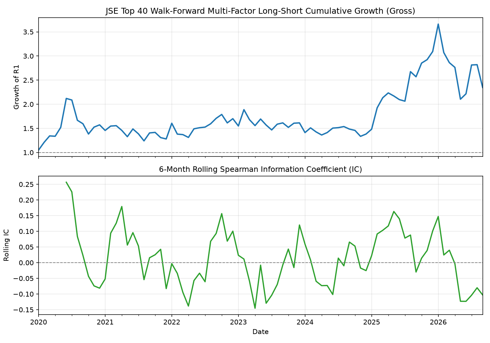

# JSE Top 40 Cross-Sectional Multi-Factor Return Model

A modular quantitative research framework evaluating cross-sectional equity return predictors across **37 liquid FTSE/JSE Top 40 constituents** (2018–2026) using walk-forward out-of-sample Ridge regression.



## 1. Objective & Hypothesis
Rather than forecasting aggregate market direction, this project ranks JSE Top 40 equities cross-sectionally at each month-end using standardized factor Z-scores to test whether top-ranked decile/quintile stocks outperform bottom-ranked peers out-of-sample.

## 2. Methodology & Architecture
* **Data Pipeline (`src/data_loader.py`):** Fetches dividend-adjusted daily closing prices (`yfinance`), handles holiday/halted ticks (`ffill(limit=3)`), and filters for `>95%` historical completeness (`2,208` trading days across `37` tickers).
* **Factor Engineering (`src/factors.py`):** Computes month-end cross-sectional Z-scores (winsorized at $\pm 3\sigma$) for:
  1. **12-1 Month Momentum:** Trailing 12-month return excluding the most recent month to avoid short-term reversal contamination.
  2. **1-Month Reversal:** Negative of prior 1-month return to capture mean reversion.
  3. **Low Volatility:** Negative of 60-day annualized realized volatility.
* **Walk-Forward Validation (`src/evaluation.py`):** Eliminates look-ahead bias by training an L2-regularized `Ridge(alpha=10.0)` model strictly on rolling 24-month windows before predicting month $t+1$ rankings and simulating an equal-weighted Long Top-5 / Short Bottom-5 portfolio.

## 3. Key Empirical Findings (2018–2026)

| Signal / Strategy | Mean Monthly Rank IC | IC Information Ratio | Notes |
| :--- | :---: | :---: | :--- |
| **12-1 Month Momentum** | **+0.0520** | +0.19 | Strongest standalone cross-sectional predictor on the JSE |
| **1-Month Reversal** | **+0.0434** | +0.16 | Captures short-term overreaction across liquid large caps |
| **Low Volatility** | **-0.0233** | -0.08 | Underperformed during high-beta JSE resource/precious-metal rallies |
| **Walk-Forward Ridge L/S** | **+0.0152** | — | **20.09%** annualized gross return, **39.71%** vol, **0.51** gross Sharpe |

## 4. Limitations & Practical Next Steps
* **Transaction Costs & Shorting Constraints:** Gross returns exclude JSE Securities Transfer Tax (STT), brokerage, bid-ask spreads, and scrip-lending borrow costs on the short leg.
* **Survivorship Bias:** Universe reflects current FTSE/JSE Top 40 constituents rather than point-in-time historical index membership.
* **Model Improvements:** Replace the 24-month rolling window with an expanding window or add sector-neutralization (separating Resources from Financials/Industrials) to prevent commodity beta from dominating factor weights.

## 5. How to Run Locally
```bash
git clone https://github.com
cd cross-sectional-factor-model
python -m venv .venv
.\.venv\Scripts\pip.exe install -r requirements.txt
```
