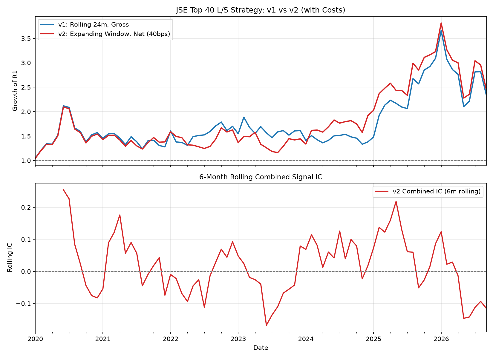

# JSE Top 40 Cross-Sectional Multi-Factor Return Model

A modular quantitative research framework evaluating cross-sectional equity return predictors across **37 liquid FTSE/JSE Top 40 constituents** (2018–2026). 

This repository documents the full research lifecycle: starting with a baseline walk-forward Ridge model (v1), running an ablation study on sector-neutralization, and deploying a realistic transaction-cost and expanding-window version (v2).



## 1. Objective & Hypothesis
Rather than forecasting aggregate market direction, this project ranks JSE Top 40 equities cross-sectionally at each month-end using standardized factor Z-scores to test whether top-ranked stocks outperform bottom-ranked peers out-of-sample. 

**Factors Engineered:**
*   **12-1 Month Momentum:** Trailing 12-month return excluding the most recent month to avoid short-term reversal contamination.
*   **1-Month Reversal:** Negative of prior 1-month return to capture mean reversion.
*   **Low Volatility:** Negative of 60-day annualized realized volatility.

## 2. The Ablation Study (What Didn't Work)
In equity research, proving what *doesn't* work is just as valuable as proving what does. 
*   **Hypothesis:** Global Z-scores allow commodity beta to dominate the rankings. Neutralizing Z-scores within sectors (e.g., ranking miners only against miners) should reduce volatility and improve stock selection.
*   **Result:** Sector-neutralization **destroyed the alpha** (Sharpe ratio dropped from 0.51 to -0.09). This empirically proved that the model’s edge on the JSE is driven by **cross-sector momentum** (i.e., detecting when the entire Resource sector enters a bull cycle), not intra-sector stock picking.

## 3. Model v2 Upgrades (Expanding Window & Costs)
To make the baseline model (v1) institutionally robust, v2 implements two critical upgrades:
1.  **Expanding Training Window:** Replaced the 24-month rolling window with an expanding window (training on all data from 2018 to \(t-1\)) and increased Ridge regularization (\(\alpha=50\)) to stabilize factor weights.
2.  **Transaction Costs:** Deducts 40 bps round-trip cost based on monthly portfolio turnover, reporting **Net Sharpe** instead of unrealistic Gross returns.

## 4. Key Empirical Findings (2018–2026)

| Metric | v1: Baseline (Rolling/Gross) | v2: Final (Expanding/Net) |
| :--- | :---: | :---: |
| **Combined Mean IC** | +0.0152 | **+0.0195** |
| **Annualized L/S Return** | 20.09% | **20.34%** |
| **Annualized Volatility** | 39.71% | **38.36%** |
| **Sharpe Ratio** | 0.51 | **0.53** |
| **Avg Monthly Turnover** | — | 52.96% |

*Note on Standalone ICs: Momentum (+0.052) and Reversal (+0.043) exhibit strong standalone predictive power. Low Volatility (-0.023) failed on the JSE due to high-beta mining rallies.*

## 5. Limitations & Next Steps
*   **Shorting Constraints:** The long-short spread does not account for JSE scrip-lending borrow costs or short-squeeze dynamics.
*   **Survivorship Bias:** The universe reflects current FTSE/JSE Top 40 constituents rather than point-in-time historical index membership.
*   **Next Steps:** Implement inverse-volatility position sizing (rather than equal-weighting top-5/bottom-5) and add a regime filter (e.g., disabling Momentum when market volatility exceeds a threshold).

## 6. How to Run Locally
```bash
git clone https://github.com/yourusername/cross-sectional-factor-model.git
cd cross-sectional-factor-model
python -m venv .venv
.\.venv\Scripts\pip.exe install -r requirements.txt